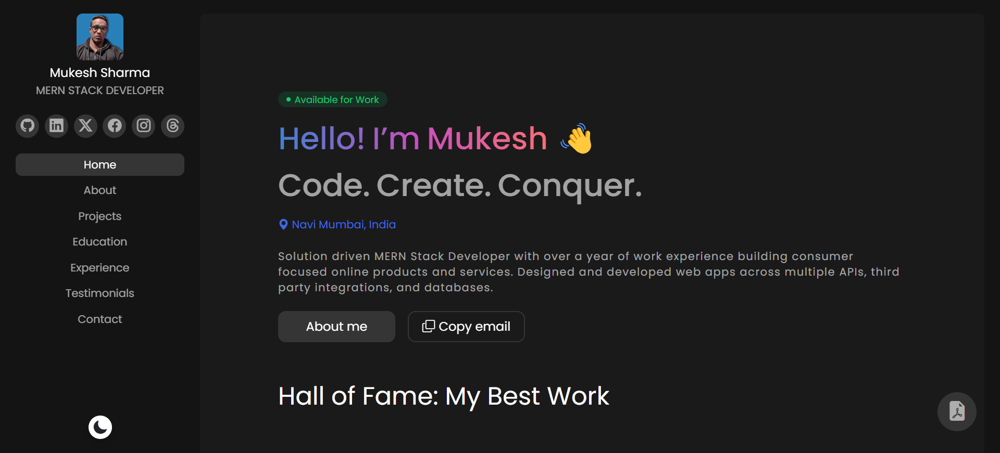

# Welcome to my Portfolio Website! 👋

I'm Mukesh Sharma, a Full Stack Developer currently working as a Software Development Engineer at Valuefy Technologies. This website brings together my experience, projects, skills and what people I've worked with have to say. It's built with Next.js, React and styled-components, with a light and dark theme.

## Home Page

A quick overview: my availability for work, a selection of featured projects, my core tech stack, and highlights from testimonials. You can copy my email address straight from the page.

## About Page

A summary of my background and a complete breakdown of my skills:

- **Frontend & UI:** HTML, CSS, JavaScript, TypeScript, React, Next.js, Angular, styled-components, Material UI, Bootstrap, Tailwind CSS
- **Backend & Databases:** Node.js, Express.js, MongoDB, SQL, Redis
- **DevOps & Tools:** Docker, OpenShift, Jenkins, Git, GitHub, Bitbucket, Postman, Agile

It also covers my interests and the languages I speak (English, Hindi and Marathi).

## Projects Page

A showcase of my professional and personal work, from backend modules built at work (NPS & Mutual Fund processing at Valuefy, Opinion Trading & League at Playerzpot) to full-stack MERN applications and frontend builds. Each project has its own page with a description, the technologies used and the project timeline.

## Experience Page

My professional journey, with the role, period, location and key contributions for each position:

- **Valuefy Technologies:** Software Development Engineer (2025 – present)
- **Playerzpot Media:** Software Development Engineer (2024 – 2025)
- **AppAvengers Labs:** Junior Web Developer (2023 – 2024)
- **NullClass:** Project Intern (2022 – 2023)
- **Hasbasoft Technology:** MERN Stack Software Trainee (2021 – 2022)

It also includes my professional certificates from internships, training and project work.

## Education Page

My academic background, from school through my Bachelor's in Information Technology at Sanpada College of Commerce & Technology (2020 – 2023), along with certificates earned during my degree.

## Testimonials Page

Recommendations from team leads, colleagues, trainers and clients I've worked with, sharing their experience of working with me.

## Contact Page

Reach me by phone, copy my email address, or send a message directly through the contact form. You can also find me on GitHub, LinkedIn and other social platforms linked throughout the site.

Thank you for taking the time to explore my Portfolio Website. I look forward to collaborating with you and turning your ideas into reality!
